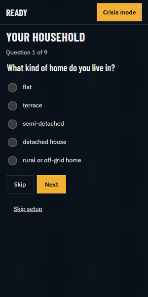

<div align="center">

# READY

**The preparedness app for people who would rather not become a "prepper".**

An offline-first, privacy-first household resilience app for the UK.
No account. No tracking. No panic. Just a calm list, and a torch that works.



**[Try it live: ready-uk.netlify.app](https://ready-uk.netlify.app)**

_Prepare, a house that scores itself, and a Crisis mode you can use at 2 am with 4% battery._

</div>

---

## Why this exists

The UK government says households should be able to cope for **at least 72 hours** without power, water or a working supermarket. Most of us have a torch somewhere. Probably. In a drawer. With the batteries in a different drawer.

Ready turns "be prepared" into something you can actually do on a Sunday afternoon with a cup of tea:

- **One thing a week.** Not a 40-item doomsday spreadsheet. One small, sensible task.
- **A ladder, not a cliff.** Three days, then seven, then ten. Climb as far as feels reasonable.
- **A crisis mode that gets out of the way.** When the lights go off, the app goes plain.

Nobody is asking you to build a bunker. Keep a few tins of beans and know where the stopcock is. You are already ahead of most of the country.

## What's inside

### Crisis mode: for when it's already happening

Black, white and amber. Huge buttons. Nothing moves. No 3D, no network, no cleverness.

- **Do:** playbooks for power cut, no water, gas smell, flood and storm. Tick steps off as you go; your place is remembered if you reload. Fridge and freezer clocks tell you when the food stops being a good idea.
- **Know:** short, plain answers (e.g. "can I use candles?") with the source and the date it was last checked.
- **Call:** the right UK number, tappable. **105** for power cuts, **0800 111 999** for gas, **111** for NHS, **999** when it's actually 999. Your water company and GP are filled in from your household profile.
- Steps adapt to you. No gas hob? You won't be told to light one.
- Built to AAA contrast with 48px minimum touch targets, and checked automatically for accessibility.

### Prepare: for when it isn't

A gentle programme built around the official **3 / 7 / 10 day** targets.

- "This week's one thing", with _Done_ and _Not now_ buttons. Not now is allowed. We're British; we understand.
- A progress ladder so you can see how far you've come.
- Quantities scale to your household: litres of water, days of food, sleeping bags.
- Rough UK prices, because nobody wants a surprise at the till.
- A reading list of official guidance, linked properly rather than paraphrased badly.

### Home: your house, scored

A 3D cutaway of your home, with each room coloured by how ready it is. Tap a room, tick what you actually own, watch the percentage move. It's weirdly satisfying, like a loyalty card for not freezing.

The **Pantry** shelf shows how many days of food you really have, against the 3, 7 and 10 day marks.

Prefer boring? There's a plain 2D view with the same numbers. It's also what you get if WebGL isn't available, or in Crisis mode, or when battery saver is on.

## Privacy, properly

- No accounts, no analytics, no adverts, no third-party requests at runtime.
- Everything lives on your device (IndexedDB, with a localStorage fallback).
- Fonts are bundled. Even the typography doesn't phone home.
- Export your data as JSON, import it on another device, or delete the lot in one tap.
- Automated tests fail the build if the app makes a cross-origin request.

## Try it

**Use it now:** open <https://ready-uk.netlify.app> on your phone and add it to your home screen. No sign-up, no app store.

**Or run it locally:**

```bash
git clone https://github.com/ChrisBrooksbank/prep.git
cd prep
npm install
npm run build
npm run preview
```

Then open <http://localhost:4173>. Install it to your home screen and switch to airplane mode. It carries on regardless, which is rather the point.

For hot-reload development use `npm run dev`.

## For the curious

| Thing    | Choice                                                                  |
| -------- | ----------------------------------------------------------------------- |
| Language | TypeScript (strict). No UI framework.                                   |
| Build    | Vite, with `vite-plugin-pwa` (Workbox) for offline                      |
| 3D       | three.js, lazy-loaded, and never loaded in Crisis mode                  |
| Tests    | Vitest (unit), Playwright + axe (smoke and accessibility)               |
| Budget   | Crisis mode and shell stay under 150 KB gzipped, enforced in CI scripts |
| Type     | Barlow Condensed, IBM Plex Sans, IBM Plex Mono                          |

Everything is checked with one command:

```bash
npm run check   # typecheck, lint, format, unit tests, build, bundle budget, smoke tests
```

### House rules

- Official targets, phone numbers and advice live in data files, each with a `source` and `lastChecked` date. Components never hard-code them.
- Any advice not taken from a spec is marked `needsReview: true` until a human has checked it.
- Pure logic (days of cover, readiness scores, timers) lives in separate, unit-tested modules.
- UK English, plain words, calm tone. No emoji, no scare copy.
- Reduced motion is respected. Dark is the default.

Specs are in [`specs/`](specs/), and the original visual prototype is [`specs/reference/concept-prototype.html`](specs/reference/concept-prototype.html).

To regenerate the GIF above: build, start `npm run preview`, then run `node scripts/make-demo-gif.mjs` (needs `ffmpeg`).

## A fair warning

Ready is an independent project. It is **not** official government advice and it is not affiliated with any government body. Advice is drawn from published UK guidance and each item shows where it came from and when it was last checked, but guidance changes. Check the linked official sources, and in an emergency, call **999**.

## Contributing

Spotted out-of-date advice, a wrong number or a typo? Open an issue; corrections to sourced data are especially welcome. Please keep the tone calm and the copy plain.

---

<div align="center">

_Keep calm and know where your stopcock is._

</div>
